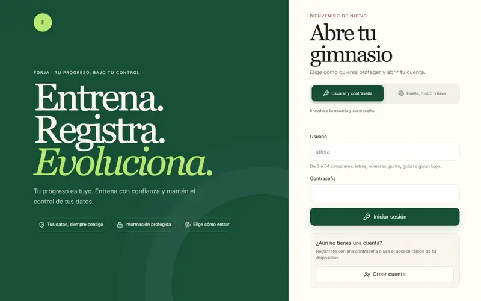
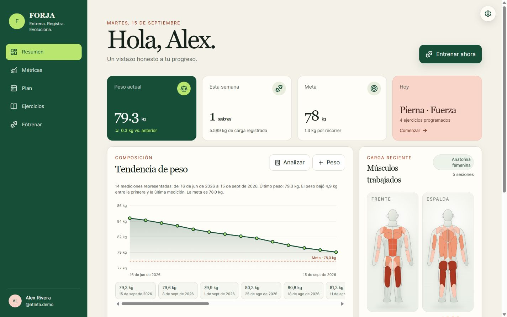
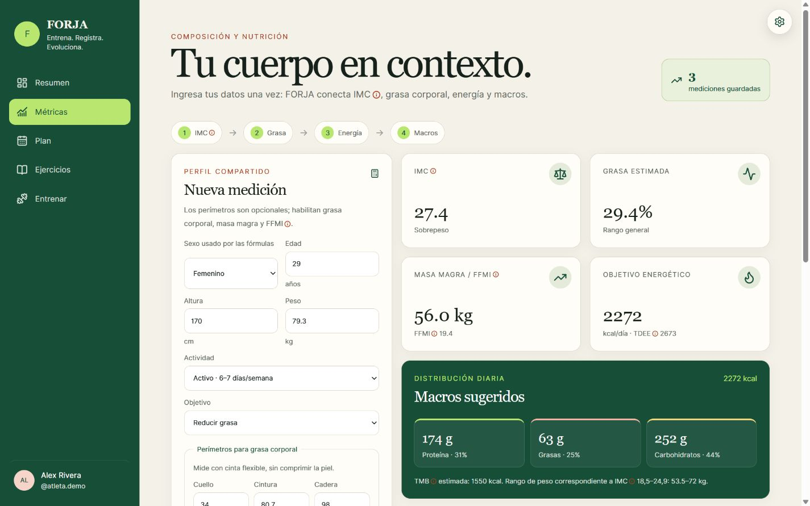
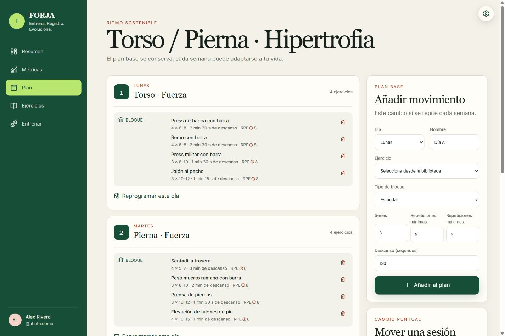
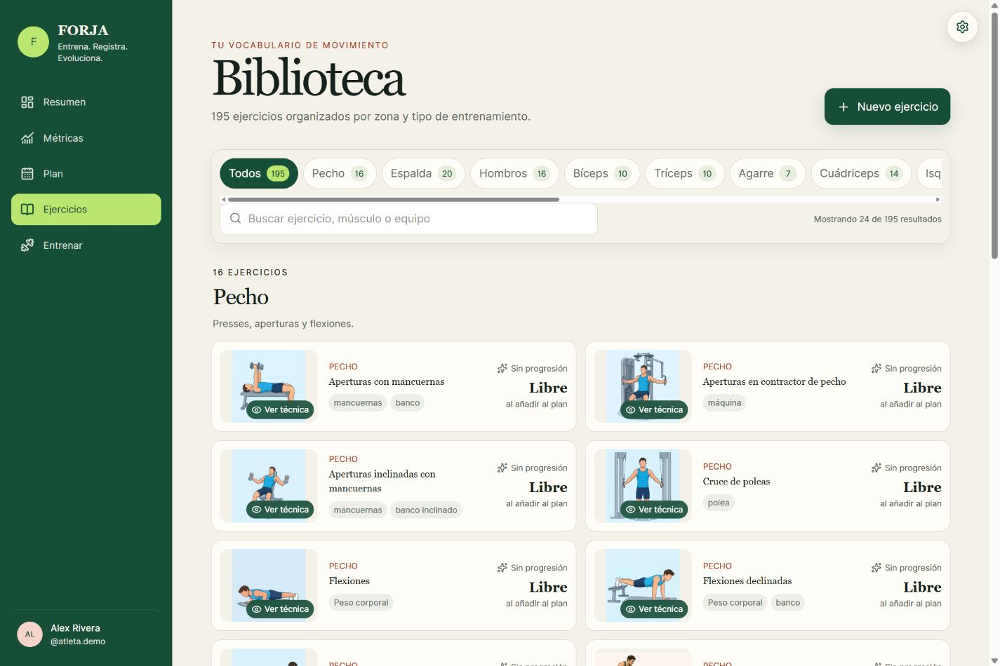
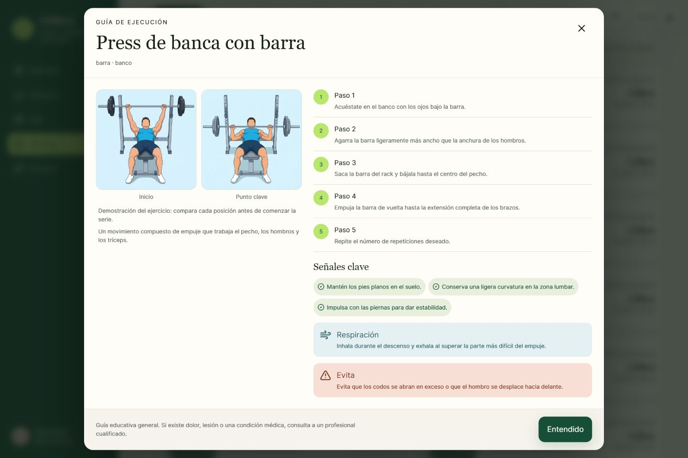
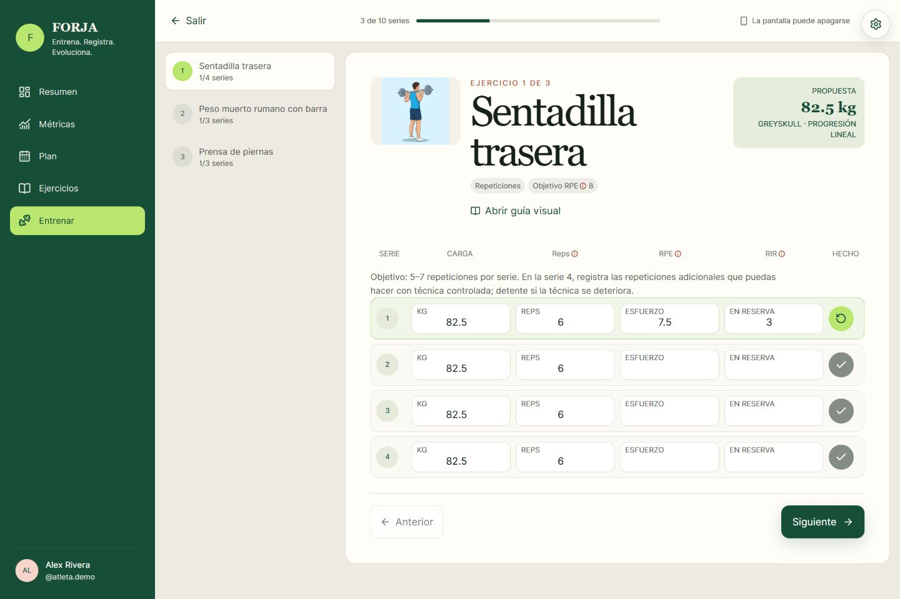
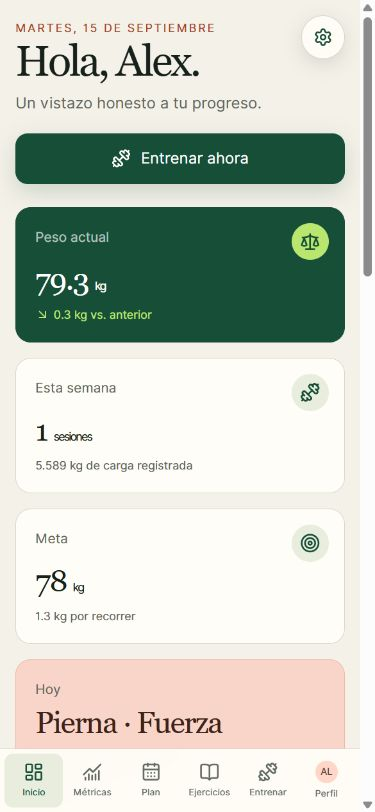

# FORJA

> Entrena. Registra. Evoluciona.

FORJA te ayuda a entrenar con constancia: planifica tus rutinas, registra cada sesión y visualiza tu progreso para avanzar hacia tus objetivos físicos.

Está pensada para quienes quieren organizar su entrenamiento de fuerza y dar continuidad a sus rutinas. Reúne tu plan semanal, el registro de cada serie y la evolución de tus mediciones en una aplicación web que puedes instalar en tu dispositivo.

**[Empezar a entrenar con FORJA](https://forja.felipepena.co)**

[](docs/media/forja-tour.mp4)

[Ver recorrido completo (video, 24 s)](docs/media/forja-tour.mp4) · [Ver el modo de entrenamiento (video, 11 s)](docs/media/forja-training.mp4) · [Ver la pantalla de acceso](docs/media/forja-login.jpg)

Los videos son montajes silenciosos de capturas de la interfaz, no grabaciones de interacción en tiempo real. El perfil y las mediciones mostrados son ficticios; no se usaron datos de usuarios reales.

## Del plan al progreso

- **Planifica una semana que encaje contigo:** genera una rutina de 2 a 6 días según tu objetivo, experiencia, disponibilidad, equipo y prioridades. Organiza tus sesiones y reprograma días concretos sin cambiar el plan base.
- **Registra cada sesión con contexto:** consulta tus cargas anteriores y anota series, repeticiones o tiempo, descansos y esfuerzo. El entrenamiento guiado te acompaña ejercicio a ejercicio para que puedas revisar lo que realmente hiciste.
- **Haz visible tu constancia y evolución:** consulta tu actividad anual, carga reciente y grupos musculares trabajados. Sigue la tendencia de peso, tu meta y el historial de mediciones corporales para reconocer cambios a lo largo del tiempo.
- **Ajusta tu entrenamiento a medida que avanzas:** recibe propuestas de carga basadas en tu registro y vuelve a revisar tus objetivos y disponibilidad desde el asistente. Puedes regenerar el plan sin borrar las sesiones anteriores.

## Herramientas para acompañar tu rutina

- **Ejercicios a tu alcance:** explora 195 ejercicios base en 16 categorías, con búsqueda, filtros y guías visuales alojadas con la aplicación. Añade ejercicios propios y una imagen para reconocerlos. Las guías base usan imágenes estáticas; los movimientos personalizados sin imagen se identifican claramente.
- **Más detalle cuando lo necesitas:** registra el esfuerzo con RPE/RIR, consulta el 1RM estimado y utiliza progresión lineal, Greyskull LP o doble progresión, con seguimiento de estancamientos y descargas. Cuando el dispositivo admite Wake Lock, FORJA solicita mantener la pantalla encendida durante la sesión.
- **Mediciones conectadas:** registra perímetros y consulta estimaciones de IMC, grasa corporal, masa magra, FFMI, gasto energético y macronutrientes. Un recordatorio mensual te ayuda a repetir las mediciones.
- **Tu rutina también sin conexión:** instala FORJA como PWA, vuelve a abrir pantallas y guías que ya consultaste y guarda cambios pendientes para sincronizarlos cuando regresa la red. Web Push puede avisarte de descansos y mediciones si el navegador y tus permisos lo permiten; su entrega no sustituye una alarma garantizada.
- **Acceso desde tu dispositivo:** crea una cuenta con usuario y contraseña, añade una o varias passkeys para volver a entrar desde tu dispositivo y administra tus métodos de acceso.

RPE significa *escala de esfuerzo percibido* y RIR, *repeticiones en reserva*. La interfaz incluye ayuda contextual para estas y otras abreviaturas. Las estimaciones de composición y nutrición son orientativas, no un diagnóstico ni una prescripción clínica.

## Un vistazo a la interfaz

| Panel y constancia | Métricas y composición |
| --- | --- |
|  |  |
| Evolución, meta, actividad y grupos musculares. | Perímetros, historial y estimaciones encadenadas. |

| Plan semanal | Biblioteca de ejercicios |
| --- | --- |
|  |  |
| Rutina por días y cambios de fecha independientes. | Búsqueda, categorías y ejercicios personalizados. |

| Guía visual | Entrenamiento guiado |
| --- | --- |
|  |  |
| Imagen y pasos para reconocer el movimiento. | Series, carga sugerida, esfuerzo y descansos. |



Las capturas son una muestra de la versión actual y pueden variar ligeramente con cambios posteriores de la interfaz.

## Tu primera sesión con FORJA

1. Abre [FORJA](https://forja.felipepena.co) y crea tu cuenta con usuario y contraseña.
2. Completa el asistente inicial con tu objetivo, experiencia, disponibilidad y equipo para generar tu plan.
3. Abre el entrenamiento guiado y registra las series de tu primera sesión.
4. Consulta el panel para revisar tu actividad y sigue registrando entrenamientos y mediciones para construir tu historial.

Puedes instalar FORJA desde el menú de tu navegador compatible para abrirla como una aplicación. Si prefieres operar tu propia instancia, consulta las guías de [Docker](#empezar-en-local-con-docker) o [Vercel + Neon](#publicar-en-vercel--neon).

## Empezar en local con Docker

Necesitas Docker con Compose. El proxy Nginx reúne la web y `/api` bajo `http://localhost:8080`, lo que permite probar WebAuthn en `localhost`. Por defecto, el puerto se vincula a `127.0.0.1` y no se publica en toda la red.

1. Copia `.env.example` a `.env` y configura `SESSION_SECRET`, `VAPID_PUBLIC_KEY` y `VAPID_PRIVATE_KEY`. No versiones `.env`. Puedes generar los valores con Node.js y la utilidad de Web Push:

   ```sh
   node -e "console.log(require('node:crypto').randomBytes(48).toString('base64url'))"
   npx web-push generate-vapid-keys
   ```

2. Deja `RP_ID=localhost`, `EXPECTED_ORIGIN=http://localhost:8080` y `PUBLIC_APP_URL=http://localhost:8080` si usarás el puerto predeterminado. Ajusta también `APP_PORT` y el origen exacto si cambias de puerto.
3. Inicia la aplicación:

   ```sh
   docker compose up -d --build
   ```

4. Abre [http://localhost:8080](http://localhost:8080) y crea tu cuenta. Comprueba los contenedores con `docker compose ps` si la página no responde.

Para detenerla sin eliminar los datos, ejecuta `docker compose stop`. El modo local guarda las cuentas y credenciales en `data/db.json` y el estado de cada usuario en `data/state-<id>.json`; ambos se excluyen de Git. Los ejemplos de estructura son [`data/db.example.json`](data/db.example.json) y [`data/state-user.example.json`](data/state-user.example.json).

> Antes de exponer Docker a Internet, coloca un proxy HTTPS delante, fija el dominio de WebAuthn y sigue las medidas de [operación y copias de seguridad](docs/production.md). No compartas el directorio JSON entre varias réplicas del backend.

## Publicar en Vercel + Neon

La instancia pública de FORJA está desplegada en Vercel con Neon y QStash, bajo el dominio `forja.felipepena.co`. En ese despliegue, `RP_ID=forja.felipepena.co`, mientras que `EXPECTED_ORIGIN` y `PUBLIC_APP_URL` usan `https://forja.felipepena.co`. Si publicas otra instancia, sustituye estos valores por tu propio dominio.

La configuración de producción sirve el frontend y `/api` desde un mismo dominio HTTPS. La función Node usa Neon PostgreSQL para cuentas, passkeys, sesiones y estados; QStash programa avisos de descanso y un cron diario recupera tareas y procesa recordatorios de perímetros. En Vercel no se utiliza el almacenamiento JSON local.

Sigue la [guía paso a paso de Vercel + Neon](docs/vercel-neon.md) para conectar la base de datos, configurar QStash y Web Push, elegir el dominio, preparar las variables y validar el despliegue. Como mínimo, revisa `DATABASE_URL`, `RP_ID`, `EXPECTED_ORIGIN`, `PUBLIC_APP_URL`, `SESSION_SECRET`, VAPID, QStash y `CRON_SECRET`. El dominio de una passkey debe permanecer estable: cambiarlo después de registrar usuarios puede impedir que esas credenciales vuelvan a funcionar.

Con `NODE_ENV=production`, configura `NPM_CONFIG_INCLUDE=dev` para instalar las herramientas de compilación. Define `QSTASH_URL` según la región de tus credenciales; para US East usa `https://qstash-us-east-1.upstash.io`.

Si ya tienes datos JSON, la guía incluye una migración con modo de simulación.

## Desarrollo y verificación

Se requiere Node.js 24. Desde la raíz:

```sh
npm ci
npm run typecheck
npm test
npm run build
npm run build --workspace=backend
node scripts/qa/verify-precache.mjs
```

Para una comprobación de contenedores con datos temporales y Docker operativo, ejecuta `node scripts/qa/compose-smoke.mjs`. La [guía de producción](docs/production.md) amplía las comprobaciones, las copias de seguridad y los límites conocidos.

| Componente | Ubicación | Responsabilidad |
| --- | --- | --- |
| Web React, Vite y PWA | [`frontend/`](frontend/README.md) | Pantallas, estado local, Service Worker y recursos de ejercicios. |
| API Node y dominio | [`backend/`](backend/README.md) | Autenticación, persistencia, sesiones, entrenamientos y Push. |
| Despliegue serverless | [`api/index.ts`](api/index.ts), [`vercel.json`](vercel.json) | API bajo el mismo origen que la PWA. |
| Instalación local | [`docker-compose.yml`](docker-compose.yml), [`nginx.conf`](nginx.conf) | Proxy Nginx, frontend, backend y archivos JSON. |
| Medios de este README | [`docs/media/`](docs/media/) | Capturas, vista previa animada y videos de demostración. |

## Privacidad, alcance y créditos

FORJA no exige una app nativa ni un servicio de correo para crear una cuenta. Las contraseñas se almacenan como derivaciones con sal; no hay recuperación automática por correo. Conserva tus métodos de acceso y realiza copias protegidas. Las respuestas privadas de `/api` no se guardan en la caché del Service Worker. Los JSON locales contienen datos personales sin cifrar a nivel de archivo; en producción debes controlar el acceso, la retención y las copias de Neon.

Las calculadoras toman inspiración funcional de [Body_Calc](https://github.com/castellanosfelipe/Body_Calc). Los datos de ejercicios proceden de [RepDB](https://repdb.co) y parte de las imágenes complementarias de [Free Exercise DB](https://github.com/yuhonas/free-exercise-db). Consulta [avisos y licencias de terceros](THIRD_PARTY_NOTICES.md) para los recursos incluidos.
